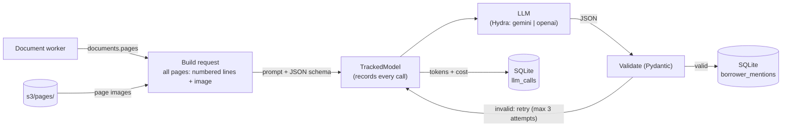

# Extraction: HLD

## Purpose

Pull borrower data out of each document with LLM: name, address, income history, and account/loan numbers, each with a reference to its source page.

## Flow

## Decisions

| Decision | Reason |
| --- | --- |
| One LLM call per document, all its pages | A document is the natural unit of context (e.g. a 1040's name and income are on different pages). Cross-document context is resolution's job. |
| Each page sent as numbered lines + image | Lines give citable text (OCR'd for scans); the image gives the layout. |
| Structured JSON output, validated with Pydantic | Malformed output is caught and retried, never stored. |
| Up to 3 attempts per document (invalid JSON or API error), then the document fails at once | Caps the cost at 3 calls per document; going through the queue's 3 retries as well would mean up to 9. |
| Every value must appear in the lines it cites (amounts, account numbers, SSN last 4, name parts); otherwise the output is invalid and retried with feedback | Catches misreads and invented values in code, with no extra LLM call unless something is wrong. |
| Every value cites a line range; page, quote and bounding boxes are looked up from parsing's lines | The model only picks line numbers it can see, so the reference can't be invented. A cited line that doesn't exist counts as invalid output. |
| Model chosen by Hydra config (`model=gemini` or `model=openai`) | Swap or benchmark models without code changes. |
| Extraction runs in the document worker, after parsing | Same retry and DLQ handling as the rest of the pipeline. |
| Models wrapped in a `TrackedModel` that records every call in `llm_calls`: model, input / cached input / output tokens, cost, duration, error | Extraction code just calls the model; tracking can't be forgotten. Failed attempts are recorded too, since they cost money. |
| Prompts and responses are not stored | They contain borrower PII. |
| Errors stored and logged as type and field path only, never the value | Validation errors would otherwise echo extracted PII into `documents.error` and the logs. |
| Paid API tier only | Provider terms: paid-tier API data is not used for training. |
| Prices per 1M tokens (input, cached input, output) in each model's Hydra config | Cost is computed when the call is made; a new model brings its own prices. |
| `hatch run costs` prints totals per batch and model | A quick cost comparison when benchmarking the two models. |

## Production note

Here each document is one call. In production, very long documents would be split into page ranges to stay within the model's context and output limits.
