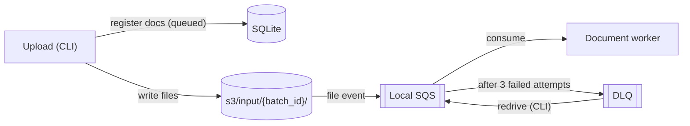

# Ingestion: HLD

## Purpose

Load a folder of documents into the pipeline as a batch, and queue one job per document.

## Flow

## Decisions

| Decision | Reason |
| --- | --- |
| CLI, not an API endpoint | The corpus is given as a folder. |
| Local folder as S3, file-based queue as SQS | Runs locally with no cloud. |
| Register all docs before processing | The worker can tell when a batch is complete. |
| sha256 dedupe | Re-runs create no duplicates. |
| 5 min visibility timeout, 3 attempts, then DLQ | No document is lost. |
| `redrive` CLI moves DLQ messages back to the queue and resets their docs to `queued` | Failed docs can be re-run after the cause is fixed. |
