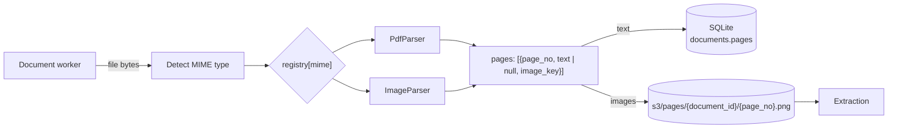

# Parsing: HLD

## Purpose

Turn any supported file into pages of text and images, so later steps never deal with file types.

## Flow

## Decisions

| Decision | Reason |
| --- | --- |
| Parser registry keyed by MIME type | A new file type is one new parser class. |
| One page shape for every file type | Extraction stays the same for PDFs, scans and images. |
| MIME type detected from bytes, not the extension | File names can't be trusted. |
| `text = null` when a page has no text layer | The scanned Title Report is read from its image. |
| Page images saved to local S3 | Easy to inspect what the LLM saw; parse and extract can be split later. |
| Unsupported type fails at once; a broken file retries, then DLQ | A retry cannot change a file type, but may get past a transient error. |

## Production note

Scanned pages have no text layer, so here the multimodal LLM reads them from the page image. That is enough for this project.

In production, scans would first go through OCR such as AWS Textract (text, tables, forms) or Tesseract. The pipeline would then extract from text plus image on every page, which is more reliable and cheaper at volume. It would be one more `Parser`, or a step after parsing that fills `text` for pages where it is `None`. Nothing downstream changes.
