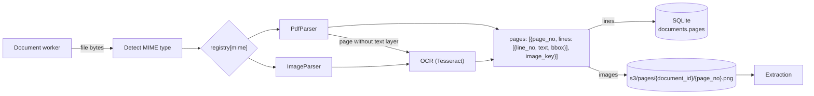

# Parsing: HLD

## Purpose

Turn any supported file into pages of numbered text lines (with their position on the page) and page images, so later steps never deal with file types.

## Flow

## Decisions

| Decision | Reason |
| --- | --- |
| Parser registry keyed by MIME type | A new file type is one new parser class. |
| One page shape for every file type | Extraction stays the same for PDFs, scans and images. |
| MIME type detected from bytes, not the extension | File names can't be trusted. |
| Text as lines, numbered across the whole document, each with a bounding box (0–1 of the page) | The LLM cites line numbers it can see; the quote and the box come from the document, so they can't be invented. |
| Text-layer pages: lines from PyMuPDF. Scans and images: lines from Tesseract OCR | Every page gets lines and boxes, including the scanned Title Report. OCR runs locally, so no PII goes to another service. |
| Page images saved to local S3 | The LLM sees the layout too; easy to inspect what it saw. |
| Unsupported type fails at once; a broken file retries, then DLQ | A retry cannot change a file type, but may get past a transient error. |

## Production note

In production, OCR would be AWS Textract instead of Tesseract: better accuracy on scans, plus tables and forms. It returns the same thing (lines with boxes), so it is one more OCR implementation behind the same interface. Nothing downstream changes.
