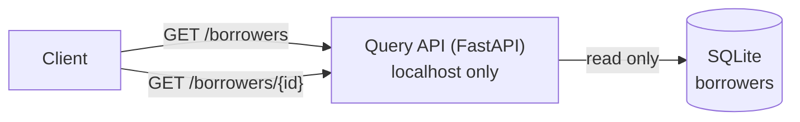

# Query API: HLD

## Purpose

Serve the resolved borrower records: each person's name, SSN last 4, addresses, accounts, income history and conflicts, with every value's sources.

## Flow

## Decisions

| Decision | Reason |
| --- | --- |
| FastAPI, read-only, two endpoints | The brief asks for a basic retrieval interface over extracted data. |
| `GET /borrowers`: id, name, conflict count per borrower | A light list to pick from. |
| `GET /borrowers/{id}`: the full stored `BorrowerRecord` | Resolution already built the record with all sources and conflicts; the API only reads it. |
| Typed response models | Validated output and generated OpenAPI docs at `/docs`. |
| Unknown id → 404 | Standard REST. |
| Bound to `localhost` | The records hold PII; nothing outside the machine can reach them. |
| SQLite in WAL mode | The API can read while the worker writes. |
| `hatch run api` | Same way to start as every other command. |

## Production note

Production would add authentication and authorization, audit logs of who read which borrower, pagination and filters on the list, and Postgres behind the same endpoints.
