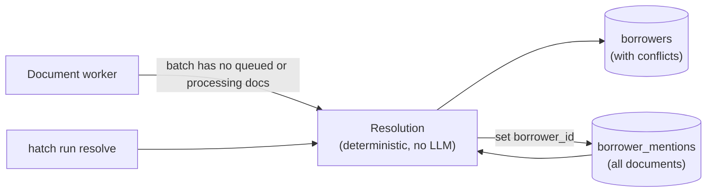

# Resolution: HLD

## Purpose

Merge the borrower mentions extracted from every document into one record per person, with their full income history and every value's source.

## Flow

## Decisions

| Decision | Reason |
| --- | --- |
| Deterministic code, no LLM | Testable, repeatable, free. |
| Runs when a batch finishes, inside the worker; also `hatch run resolve` | Records are built once from all the evidence; the command re-runs it after a fix or redrive. |
| Rebuilds all borrowers from all mentions each time | Idempotent and simple: a person can appear in several batches. Fine at this volume. |
| A person is matched by normalized full name | Names are the one identifier on every document. |
| Account and loan numbers are not used to match people | Joint accounts and loans belong to two people (e.g. the Homeowners' checking account and loan). |
| SSN last 4 is kept, not used to split or merge; conflicting values are all kept and flagged | The corpus has one person with two different values (Mary: 2000 on the 1040, 2222 on the 1008). Splitting her would create a false second borrower. |
| Residence and property addresses kept separately | The property is the loan's subject, not where the person lives. |
| Accounts merged by number | The same account appears on several documents. |
| Income history: every figure with all its sources; the same figure from several documents listed once | Full history, traceable, no double counting. |
| No income summed across documents | Documents overlap (W-2, 1040 and EVOE all report 2024) and partly disagree. Each document's own total is shown as stated. |
| A year-to-date figure covering Jan 1 to Dec 31 is shown as that year's figure | Same money as a full-year figure. |
| Disagreements across documents are flagged, never silently resolved: each borrower has a `conflicts` list (field, each value, each value's sources) | Code can't tell which document is right. Whoever uses the record sees both values and where each came from. |
| Conflicts checked: a person's SSN last 4; income with the same kind, payer, period and basis but different amounts | Figures that measure different things (e.g. W-2 box 1 wages vs an EVOE's base pay) are not conflicts. |
| Conflicts are logged by field path only | No PII in logs. |

## Production note

Flagged conflicts would go to a human review queue. The reviewer's choice is stored as an override that later runs respect.

Name matching would not be enough at scale: two people can share a name, and names are spelled differently across documents. Production would match on several identifiers (full SSN held encrypted, date of birth, address history) with a confidence score, and send uncertain matches to human review.
