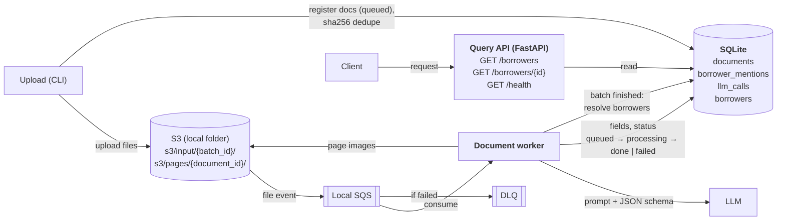

# System Design: Loan Document Extraction

This system extracts unstructured borrower data from a corpus of loan documents and serves it through an API.

## Requirements

### Functional

1. Ingest unstructured data.
2. Extract name, address, full income history, and associated account/loan numbers.
3. Provide a clear reference to the original document(s).
4. Show the extracted data.

### Non-functional

1. Accuracy over speed.
2. Zero document loss.
3. Idempotent re-runs.
4. PII handling: PII leaves the machine only to the LLM provider, on a paid API tier that doesn't train on our data; never in logs.

## Corpus

`data/loan_data/` contains 10 PDFs:

- **Borrowers span documents.** Some documents cover John only, some cover both, so per-document extractions must be merged into one record per borrower.
- **Not every document is about the same household.** Nine are about John and Mary Homeowner; the Title Report is about Robert and Andrea VanAssen, so they become separate borrowers.
- **One document is scanned.** The Title Report has no text layer, so its text comes from OCR (Tesseract), and extraction also sees the page images.
- **Income history has several sources:** 1040 + Schedule C, W-2, paystub and EVOE.

## Architecture

## Storage

All state is kept in SQLite:

| Table | Written by | Holds |
| --- | --- | --- |
| `documents` | ingestion, parsing | file name, hash, status, safe error, document type, parsed page text |
| `borrower_mentions` | extraction | each document's extracted borrower data, with sources |
| `llm_calls` | extraction | tokens, cost, duration and error type per LLM call |
| `borrowers` | resolution | one merged record per borrower, with sources and conflicts |

Resolution runs in the worker once a batch has no `queued` or `processing` documents left, and can be rerun with `hatch run resolve`.

## Models

The model is selected through Hydra config (`model=<name>`), so both can be run on the same corpus and their results compared.

| Config | Model 
| --- | --- 
| `conf/model/gemini.yaml` | Gemini 3.5 Flash-Lite (`gemini-3.5-flash-lite`) 
| `conf/model/openai.yaml` | GPT-4o mini (`gpt-4o-mini`) 

Both models accept image input and support JSON schema output.

A benchmark (each model's accuracy against labelled ground truth) will be added once there are more sample documents.

## Cross-cutting

### Failure handling

- **Success:** a message is removed from the queue only after the worker has committed its results.
- **Retryable failure:** the message is redelivered after a 5-minute visibility timeout. After 3 failed attempts, it moves to the DLQ and the document is marked `failed`. `hatch run redrive` moves it back to the queue.
- **Non-retryable failure:** an unsupported file type, or extraction failing all its LLM attempts. The document is marked `failed` at once and the message is deleted, with no DLQ round trip.
- **Malformed message:** deleted, since redelivery can't fix it.
- **Zero loss:** every document ends as `done` or `failed`, and any `failed` document can be found in the database.

### Logging

- Every process (the upload CLI, the worker and the API) logs to two places:
  - **stdout:** plain one-line text, for following a run in the terminal.
  - **A file under `log/`:** JSON, for inspecting and parsing a run afterwards.
- Each run gets its own file: `log/{YYYY-MM-DD}/{HH-MM-SS}/{process}.log`. This is Hydra's run-directory convention.
- Each line carries the context it has: `stage`, `batch_id`, `document_id` and `status` from the pipeline, `request_id` from the API.
- Logs contain IDs only, never PII values.

### PII

| Where | Handling |
| --- | --- |
| LLM provider | Receives the document pages. Paid API tier only (no training on our data). |
| Logs, queue messages, `llm_calls` | IDs, token counts and costs only. No document content, prompts or responses. |
| Error messages | Error type and field path only, never the value (validation errors would otherwise echo extracted data). |
| SSN | Only the last 4 digits are extracted. |
| Query API | Bound to `localhost`. |
| Git | `data/`, `loan.db`, `s3/`, `queue/` and `log/` are ignored. |

Known gaps, accepted for a local project: SQLite (parsed page text, extracted mentions and borrower records), `s3/` and page images are unencrypted on disk, and file names (which contain borrower names) are stored in `documents.filename` and S3 keys.

In production:

- Encryption at rest (KMS), with field-level encryption or tokenization for sensitive values.
- Authentication and authorization on the API, and audit logs of who read which borrower.
- An LLM inside our own cloud boundary (e.g. AWS Bedrock in a VPC), or a zero-data-retention agreement with the provider.
- Retention rules: delete raw files and page images after extraction.
