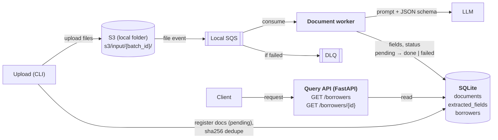

# System Design: Loan Document Extraction

This system extracts unstructured borrower data from a corpus of loan documents and serves it through an API.

## Requirements

### Functional

1. Ingest unstructured data.
2. Extract name, address, full income history, and associated account/loan numbers.
3. Provide a clear reference to the original document(s).
4. Show the extracted data.

### Non-functional

1. Accuracy over speed.
2. Zero document loss.
3. Idempotent re-runs.
4. PII handling.

## Corpus

`data/loan_data/` contains 10 PDFs about the same household (John and Mary Homeowner):

- **Borrowers span documents.** Some documents cover John only, some cover both, so per-document extractions must be merged into one record per borrower.
- **One document is scanned.** The Title Report has no text layer, so extraction must be able to read page images.
- **Income history has several sources:** 1040 + Schedule C, W-2, paystub and EVOE.

## Architecture

## Storage

All state is kept in SQLite: `documents` (ingestion), `extracted_fields` (extraction) and `borrowers` (resolution).

## Models

The model is selected through Hydra config (`model=<name>`), so both can be run on the same corpus and their results compared.

| Config | Model 
| --- | --- 
| `conf/model/gemini.yaml` | Gemini 3.6 Flash (`gemini-3.6-flash`) 
| `conf/model/openai.yaml` | GPT-4o mini (`gpt-4o-mini`) 

Both models accept image input and support JSON schema output.

## Cross-cutting

### Failure handling

- **Success:** a message is removed from the queue only after the worker has committed its results.
- **Failure:** the message is redelivered after a 5-minute visibility timeout. After 3 failed attempts, it moves to the DLQ and the document is marked `failed`.
- **Zero loss:** every document ends as `done` or `failed`, and any `failed` document can be found in the database.

### Logging

- Every process (the upload CLI, the worker and the API) logs to two places:
  - **stdout:** plain one-line text, for following a run in the terminal.
  - **A file under `log/`:** JSON, for inspecting and parsing a run afterwards.
- Each run gets its own file: `log/{YYYY-MM-DD}/{HH-MM-SS}/{process}.log`. This is Hydra's run-directory convention.
- Each line carries `batch_id`, `document_id`, `stage` and `status`.
- Logs contain IDs only, never PII values.
